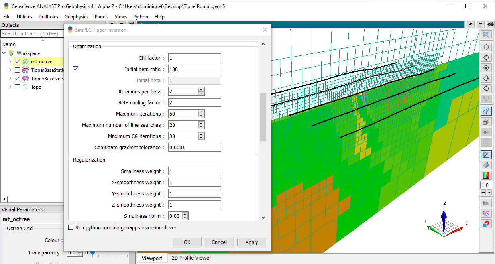

# Fundamentals

This module covers the core concepts of geophysical inversion, including the inversion framework, data misfit, regularization, mesh design, joint inversion strategies, depth of investigation, and tiling/nested meshes.

- [Background](background): An overview of the inversion framework.
- [Data Fit](data_misfit): Assigning uncertainties and global target
  (data misfit).
- [Regularization (Constraints)](regularization): Adding modeling
  constraints (regularization).
- [Mesh Design](mesh_design): Designing an inversion mesh.
- [Joint/Coupling Strategies](joint_inversion/index.md): Inverting multiple
  geophysical surveys.
- [Depth of Investigation](depth_of_investigation): Using sensitivities
  to set depth extents
- [Tiling and Nested Meshes](tiling.md): Splitting a
  survey into tiles with local nested meshes

